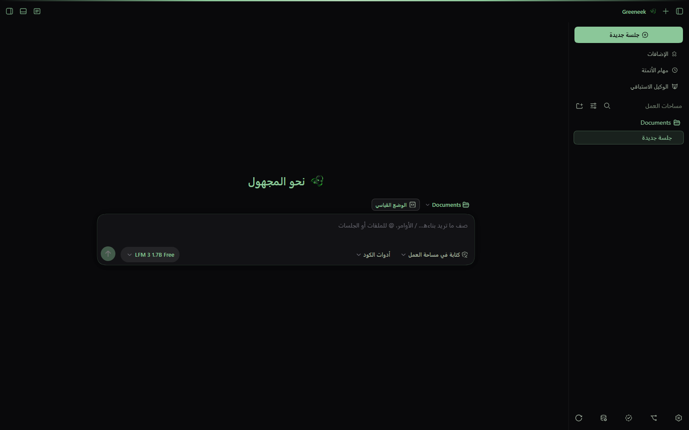
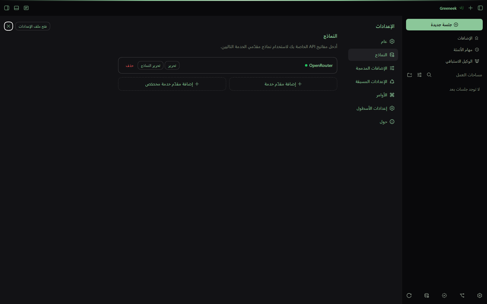

<div align="center">


# Greeneek

**An independent agent harness for real work.**

`v0.8.8` · Developer preview · MIT

[Web UI](#run) · [Architecture](#how-it-works) · [Documentation](#learn-more) · [Origins](#origins-and-attribution)

</div>

---

## What is Greeneek?

Greeneek (`gnk`) is an open-source harness for building and running agents that work in your workspace. Every capability — sessions, tools, models, providers, execution, UI surface — is a Cordis plugin composed at runtime, so the product can be reshaped without forking the core.

Bring your own model key, choose a workspace, and talk to the agent in the Web or Desktop app. It can read and edit files, run shell commands, use browser and terminal tools, delegate to teammates, keep durable task records, and remember its work across sessions.

Greeneek operates no inference service and bundles no model provider. Model routes are yours to configure, and the harness keeps its own identity, architecture, and roadmap.

## Why Greeneek

**Composed, not monolithic.** 285 workspace packages are organized by capability family. A shipped profile is a patch-layer stack over a base composition; you can disable, replace, or insert a row from configuration.

**Your models, your rules.** Provider adapters are plugins behind one LLM seam. Add a key in **Settings → Models** or via the matching environment variable, then switch routes per session. OpenAI-compatible endpoints are supported alongside native adapters.

**Durable work.** The session log is the source of truth. Prompts, tool calls, plans, and agent lifecycle events are reconstructable from it, which makes replay and recovery possible instead of relying on in-memory state.

**One conversation, more reach.** CTC is an opt-in control in the chat composer that adds `run_code` beside the ordinary tool list. Nested tool calls still pass through the normal registry, approval, and permission path.

**Several ways in.** Web GUI, Desktop app, headless CLI runs, an automation-only ACP server, and TypeScript and Python SDKs all start from the same `gnk` profiles.



## What you can do

| Area | Capability |
| --- | --- |
| **Chat** | Durable sessions, workspace selection, streaming replies, prompt continuation, and a CTC control in the composer |
| **Tools** | Filesystem, shell, persistent terminal, web search and fetch, LSP, browser, diff and pull-request surfaces |
| **Delegation** | Fleet and Team execution, in-process and out-of-process members, Maestro lanes, and subagent results delivered to the Lead's mailbox |
| **Automation** | Host-wide tasks with real execution, run history, schedules, pause/resume, and persistence in an isolated GNK home |
| **Deep-agent** | An independent proactive runtime with Triggers, Decisions, Tickets, policy rules, prompts, and a Discord source adapter |
| **Plugins** | A documented plugin lifecycle: author a bundle, install into a profile with `gnk plugin`, boot it as a layer, and remove it |
| **Integrations** | ACP automation server, MCP client, hook bridges, and SDKs for TypeScript and Python |

Provider setup happens in the app:



## How it works

The `gnk` CLI is the single application launcher. A named profile composes the Cordis plugin tree, and the shipped profiles are `web`, `headless`, `sdk`, and `acp`. Nothing outside a profile is a supported application entry point.

The product spine owns sessions, prompt assembly, the tool registry, agents, and the default agent loop. Capability families provide the implementation behind each seam: subprocess and shell, terminal, filesystem, sandbox, LLM adapters, subagents, workflow, compaction, skills, web, LSP, and more. A generated Typert graph carries remote types between Host and Client faces.

- [Architecture map](docs/architecture.md) — composition, seams, and extension points
- [Subsystems reference](docs/subsystems/README.md) — type definitions and runtime semantics
- [Package groups](packages/README.md) — the capability families and their roles

## Run

### From npm

```sh
npx @greeneek/gnk web
```

The Web UI opens at `http://127.0.0.1:3080` for a local launch. Use `--no-open` to run the server without opening a browser. Under SSH, the command prints the forwarded URL instead.

### Run from source

Requires Node.js and pnpm:

```sh
git clone https://github.com/Mostafa-Taher-git/Greeneek.git
cd Greeneek
pnpm install
pnpm run build
pnpm gnk web
```

### Desktop

Download a `desktop-v*` build from [GitHub Releases](https://github.com/Mostafa-Taher-git/Greeneek/releases). The Desktop app boots the same local Web UI and packages its own runtime assets. See the [desktop guide](docs/user/guide/desktop.md).

## First session

1. Start the Web UI and open its URL.
2. Open **Settings → Models** and add a key for a provider you use, or set the matching environment variable before launch.
3. Click **Choose workspace** and select the project directory you started `gnk` in.
4. Click **New Session**, choose a mode, and send a task. Approve operations when the active permission policy asks.

The [user guide](docs/user/guide/index.md) covers model routes, custom endpoints, workspaces, scheduling, the Python SDK, and GitHub review workflows.

## Project status

Greeneek is in **developer preview** and iterating quickly; compatibility-breaking changes are expected between releases. The current product version is `0.8.8`. Independent version families (session format, SQLite schema, desktop builds, protocols) carry their own version numbers.

Review the [safety notice](SAFETY.md) before running the harness. Known gaps and QA findings are tracked in [GitHub Issues](https://github.com/Mostafa-Taher-git/Greeneek/issues).

## Learn more

- [User guide](docs/user/guide/index.md) — setup and everyday workflows
- [Development guide](docs/development.md) — repository layout, checks, and contribution workflow
- [Plugin tutorial](docs/user/develop/basic/index.md) — build and install your first bundle
- [Configuration reference](docs/config-catalog.md) — every accepted config field by package
- [Architecture](docs/architecture.md) — how the pieces fit together

For agents contributing to this repository, start at [AGENTS.md](AGENTS.md).

<!-- rebrand:ignore-start - upstream attribution; the brand pass must keep these lines verbatim (MIT obligation). -->
## Origins and attribution

Greeneek is a fork of [DeepSeek Harness](https://github.com/deepseek-ai/deepseek-harness) (`dsh`), MIT-licensed. The fork point is upstream commit `818c4f344e` (release `0.1.2-rc.1`, 2026-09-03); upstream commits after that point are not automatically tracked — the plugin architecture, the `@greeneek` rescope, and the brand are all Greeneek-local work on that foundation. The [LICENSE](./LICENSE) carries both copyright notices, and [THIRD_PARTY_NOTICES.md](THIRD_PARTY_NOTICES.md) records the harness's dependency disclosures.
<!-- rebrand:ignore-end -->

Since that fork, Greeneek has developed independently: its own package namespace and release sequences, a Typert-generated remote type layer, a Web and Desktop product surface, a session-log-centered persistence model, a chat-integrated CTC control, Fleet and Maestro orchestration, host-wide automation execution, a Deep-agent runtime, and its own documentation and contribution conventions. The upstream foundation is acknowledged above; the direction and maintenance are Greeneek's own.

## License

[MIT](LICENSE)
